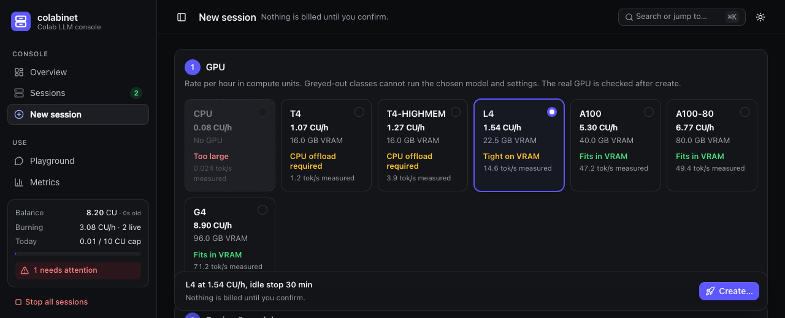

# colabinet

Run open-weight LLMs on Google Colab GPUs and use them from your own machine as a local, OpenAI-compatible
endpoint, with a web console that keeps the compute-unit (CU) bill under control.

colabinet creates and stops Colab runtimes through Google's official
[`google-colab-cli`](https://github.com/googlecolab/google-colab-cli), installs an inference engine
(llama.cpp, ExLlamaV3 or Strata) on the VM, serves the model through a private SSH tunnel on a local port, meters
every request into a local SQLite database, and stops sessions on idle time, a deadline, a per-session CU cap or a
daily CU cap.



## Features

- **One-click sessions:** pick a preset or any Hugging Face model, a GPU class, context and KV cache; colabinet
  creates the runtime, installs the engine, downloads the model and opens the tunnel.
- **GPU suitability:** GPU classes that cannot run the chosen model and settings are greyed out, and each class
  shows the speed measured on real Colab runtimes.
- **Cost guards:** idle stop, deadline, per-session and daily CU caps, low-balance alerts, and confirmed stops.
- **OpenAI-compatible endpoint** on `127.0.0.1` for any client, with streaming, vision and reasoning effort.
- **Metrics:** tokens, latency and speed for every request, with a query builder, read-only SQL and CSV export.
- **Playground**, live runtime resources (CPU, RAM, disk, GPU), engine logs, multiple Google accounts, and a
  terminal CLI (`colabinet ctl`) for everything the console does.

## How it works

```
your machine                                          Google Colab runtime
┌──────────────────────────────────┐                 ┌──────────────────────────────┐
│ colabinet console :7860          │  colab CLI      │ llama-server / TabbyAPI /    │
│  supervisor, guards, SQLite      │ ──────────────▶ │ Strata on 127.0.0.1:8090     │
│ metering proxy 127.0.0.1:3080/v1 │ ◀── SSH tunnel ─│                              │
└──────────────────────────────────┘                 └──────────────────────────────┘
        ▲ OpenAI-compatible clients
```

Everything listens on `127.0.0.1`. The tunnel goes through `colab ssh`; no third-party tunnel service is used.

## Requirements

- macOS (the supported host) with Python ≥ 3.12 and [uv](https://docs.astral.sh/uv/)
- [`google-colab-cli`](https://github.com/googlecolab/google-colab-cli) ≥ 0.7.4, signed in to your Google account
- An Ed25519 SSH key usable without a passphrase prompt (Colab rejects RSA keys)
- **Paid Colab access with a positive compute-unit balance** for real sessions: Colab only allows SSH to paid
  runtimes. See the [Colab FAQ](https://research.google.com/colaboratory/faq.html).

No local GPU, CUDA or PyTorch is needed.

## Quick start

The [installation guide](docs/installation.md) walks through every step on a fresh Mac, including Google
sign-in, multiple accounts, SSH keys and troubleshooting. In short:

```bash
# 1. uv and Python
curl -LsSf https://astral.sh/uv/install.sh | sh
uv python install 3.12

# 2. Google's Colab CLI (a separate tool)
uv tool install --python 3.12 --upgrade 'google-colab-cli>=0.7.4'
uv tool update-shell                      # then open a new terminal

# 3. colabinet
git clone https://github.com/cdownsimon/colabinet.git
cd colabinet
uv sync --frozen --python 3.12

# 4. Sign in, prepare an SSH key and check the setup (none of this allocates a runtime)
uv run colabinet login
ssh-keygen -t ed25519 -f ~/.ssh/colabinet_ed25519 -N '' -C colabinet
uv run colabinet doctor --ssh-key ~/.ssh/colabinet_ed25519

# 5. Start the console
uv run colabinet --ssh-key ~/.ssh/colabinet_ed25519 --stop-on-exit
```

Open **http://127.0.0.1:7860**, go to **New session**, choose a preset and a GPU, set an idle stop and a CU cap,
and confirm **Create**. Creating a session is the step that spends compute units. Once it is **ready**, its
endpoint is shown on the session page.

Without `--stop-on-exit`, quitting the console with Control-C leaves its sessions running; the console's guards
only work while it runs.

## Use a session

Any OpenAI-compatible client works. The endpoint ignores the API key, but some clients require one:

```python
from openai import OpenAI

client = OpenAI(base_url="http://127.0.0.1:3080/v1", api_key="none")
reply = client.chat.completions.create(
    model="qwen/qwen3.8-27b",
    messages=[{"role": "user", "content": "Explain KV caches in one paragraph."}],
)
print(reply.choices[0].message.content)
```

```bash
curl http://127.0.0.1:3080/v1/chat/completions -H 'Content-Type: application/json' \
  -d '{"model": "qwen/qwen3.8-27b", "messages": [{"role": "user", "content": "Hello"}]}'
```

The Playground page shows ready-to-copy Python and curl snippets for each session. Images go in OpenAI
`image_url` content parts; `reasoning_effort` (`none`, `low`, `medium`, `high`) controls thinking on Qwen3.8.

## Terminal CLI

Every console action is also available from a terminal while the console runs:

```bash
uv run colabinet ctl create --name llm --gpu L4 --preset qwen38-27b-q4km --idle 20 --cap 1
uv run colabinet ctl list                 # sessions, states and endpoints
uv run colabinet ctl alerts
uv run colabinet ctl stats
uv run colabinet ctl stop 1
```

`ctl create` shows the rate and worst-case cost and asks for confirmation. Run `uv run colabinet ctl --help` for
the full list, including reconfigure, restart, logs and stopping runtimes colabinet does not manage.

## Try it without Colab

```bash
uv sync --group dev
uv run python scripts/demo_console.py     # http://127.0.0.1:7869
```

The demo runs the real console against fake Colab and engine processes. It needs no Google account or GPU and
spends no compute units; Control-C cleans everything up.

## Models and GPUs

Presets live in [`presets.toml`](presets.toml): Qwen3.8-27B as llama.cpp GGUF and ExLlamaV3 EXL3 builds, and
Qwen3.8-Flash-Next as a llama.cpp GGUF and three Strata quants, each in original or abliterated variants where
available. Each preset sets per-GPU context and KV-cache defaults, and records speeds measured on real runtimes.
Any other Hugging Face model can be launched from New session; Models then offers a TOML snippet to save it as
a preset.

| GPU class | VRAM | host RAM | rate (CU/h) | good for |
|---|---:|---:|---:|---|
| CPU | — | 13.6 GB | 0.08 | testing the pipeline with tiny models |
| T4 / T4-HIGHMEM | 16 GB | 13.6 / 54.8 GB | 1.07 / 1.27 | small models; 27B GGUF only with slow CPU offload |
| L4 | 22.5 GB | 56.9 GB | 1.54 | 27B models (13–16 tok/s), Strata Flash-Next |
| A100 / A100-80 | 40 / 80 GB | 89.6 / 179.4 GB | 5.30 / 6.77 | 27B models (~45 tok/s), Flash-Next |
| G4 (RTX PRO 6000) | 96 GB | 189.9 GB | 8.90 | the fastest: 27B at ~70 tok/s, Flash-Next at 50–90 tok/s |

Rates and allocations vary by account and over time. See [engines and presets](docs/engines.md) for the
`presets.toml` format, how GPU suitability is decided and engine-specific options, and the
[benchmarks](docs/benchmarks/) for the measurements.

## Safety, cost and privacy

- Creating, reconfiguring, retrying and stopping sessions all require explicit confirmation.
- Guards stop a session on its idle limit, deadline or CU cap, and a daily cap (10 CU by default) covers all
  managed sessions; it can be raised for the rest of the day. Stops are confirmed against `colab sessions`, and
  runtimes colabinet did not create are flagged rather than adopted.
- Cost shown in the console is an estimate (rate × runtime). Colab's own balance is authoritative.
- SQLite stores metrics and lifecycle events, never prompt or response bodies or Playground history.
- All state lives in the data directory: `data/` in a source checkout, else `~/.local/share/colabinet`
  (override with `--data-dir`). It holds the database and logs, plus two owner-only secrets: the console's API
  token and, for accounts added in Settings, their Google OAuth credentials. Keep it out of version control and
  shared folders.
- Browser actions are protected by Host/Origin checks and a per-process CSRF secret; JSON clients use the API
  token in the data directory.

## Development

```bash
uv sync --group dev
uv run pytest                 # unit and integration tests with fake Colab, fake engines and a local tunnel
uv run ruff check src tests
```

The test suite never talks to Colab. Browser regression tests need Google Chrome and Node.js and are skipped
without them. Don't run the suite alongside the demo console or another test run: their fake tunnels compete
for ports.

| path | contents |
|---|---|
| `src/colabinet/` | supervisor, CLI wrapper, tunnels, metering proxy, guards, store, web console |
| `src/colabinet/vm/` | scripts that run on the Colab VM: engine setup, status and detached launcher |
| `src/colabinet/engines/` | per-engine adapters |
| `presets.toml` | default model presets |
| `tests/` | unit and integration tests, fakes and recorded fixtures |
| `docs/` | installation, Colab facts, engines and benchmarks |

## Documentation

- [Installation and Google sign-in](docs/installation.md)
- [Engines, presets and GPU suitability](docs/engines.md)
- [Colab facts colabinet relies on](docs/colab-facts.md)
- [Benchmarks](docs/benchmarks/)

## Disclaimer

colabinet is an independent project, not affiliated with or endorsed by Google. Using it spends your Colab
compute units, and you are responsible for following Colab's terms of service and each model's licence.

## License

[MIT](LICENSE)
